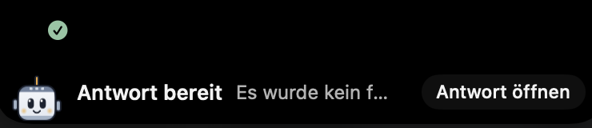
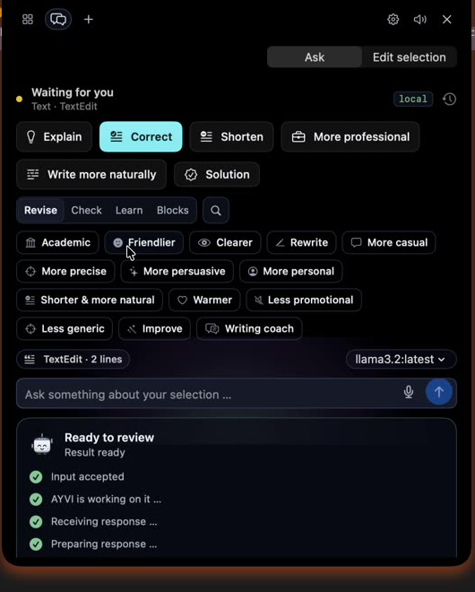
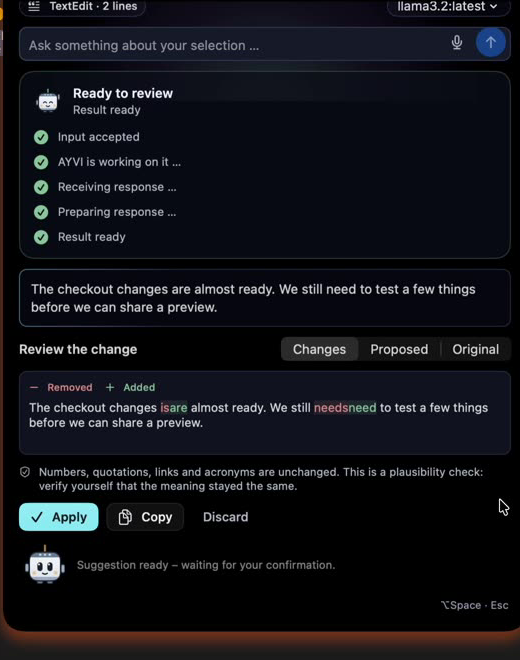

# AYVI

**Your AI companion for the Mac.** 
Select text or code, press <kbd>⌥</kbd><kbd>Space</kbd>, review the change, apply it.

[getayvo.com](https://getayvo.com) &nbsp;·&nbsp; macOS — **Coming Soon**

 

 

## Features

- **Selection first.** <kbd>⌥</kbd><kbd>Space</kbd> in any app opens the actions that fit what you selected — right next to it.
- **Review before apply.** Edits appear as a word-level diff. You confirm, AYVI revalidates the selection, and Undo stays available.
- **Local or cloud.** Run on-device or connect a cloud provider. API keys stay in the macOS Keychain.
- **Private by design.** AYVI reads only your selection, only when you trigger it. Password fields are never captured.
- **Pixel, in the notch.** The mascot shows when AYVI is working, waiting, or has an answer ready.

## In action

<table>
<tr>
<td width="50%" align="center"></td>
<td width="50%" align="center"></td>
</tr>
<tr>
<td align="center"><b>Pick an action</b></td>
<td align="center"><b>Review the edit</b></td>
</tr>
</table>

## Availability

macOS 14+ — **Coming Soon.** Updates at **[getayvo.com](https://getayvo.com)**.

---

This repository is a showcase. AYVI's source code is developed in a private repository. 
© 2026 Visam Jamil. All rights reserved. The AYVI name, logo and the Pixel mascot may not be used without permission.
