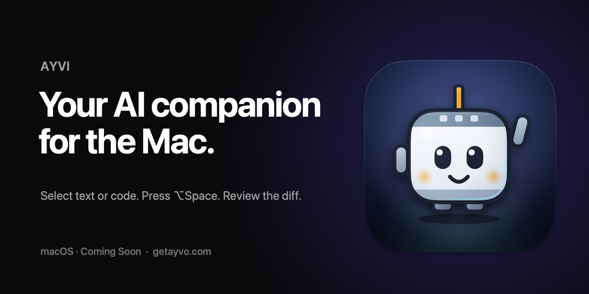

# AYVI

**Your AI companion for the Mac.**

Select text or code. Press <kbd>⌥</kbd> <kbd>Space</kbd>. Review the result, then decide what to apply.

**macOS 14+ · Coming Soon**

[Website](https://getayvo.com) · [Contact](mailto:support@getayvo.com)

 

## Made for your workflow

- **Stay in context.** Work with selected text or code through actions that appear beside your current task.
- **Review before applying.** Preview suggested edits as a word-level diff, then apply, copy or discard them.
- **Local or cloud.** Use supported on-device models or connect a cloud provider. API keys are stored in the macOS Keychain.
- **Privacy in your control.** AYVI is invoked by you and excludes password fields from selection capture.
- **Meet Pixel.** A little companion in the notch helps show when an answer is ready.

## A look inside

These are screenshots from an **early development build**. The interface may change before release.

See app screenshots

  

<table>
<tr>
<td width="50%" align="center"></td>
<td width="50%" align="center"></td>
</tr>
<tr>
<td align="center">Choose an action</td>
<td align="center">Review the change</td>
</tr>
</table>

## Availability

AYVI is in development for **macOS 14+**. There is no public download yet.

Follow updates at **[getayvo.com](https://getayvo.com)** or get in touch at **[support@getayvo.com](mailto:support@getayvo.com)**.

---

This repository is a public showcase. AYVI's current source code is developed privately. 
© 2026 Visam Jamil. All rights reserved. The AYVI name, logo and Pixel mascot may not be used without permission.
